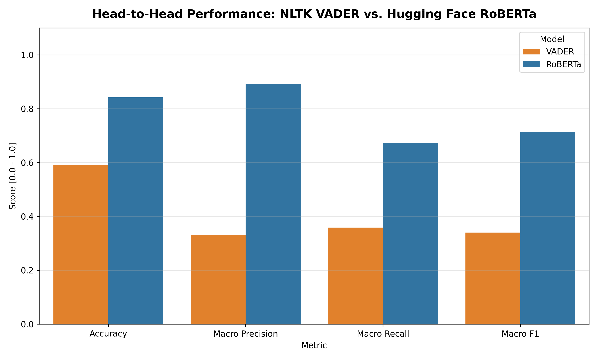
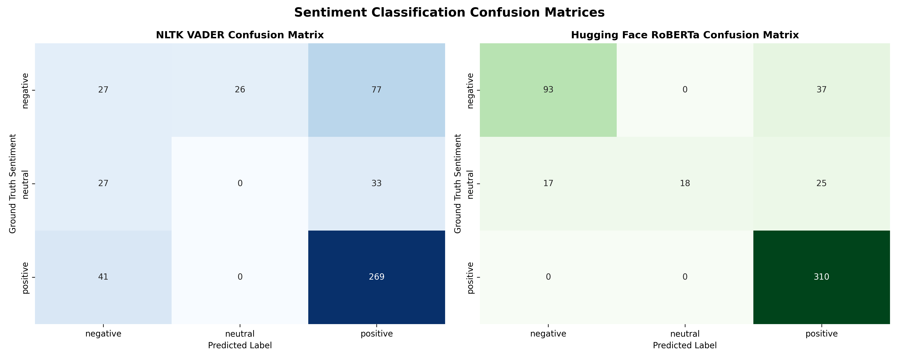
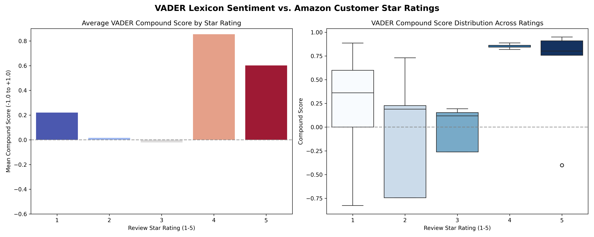
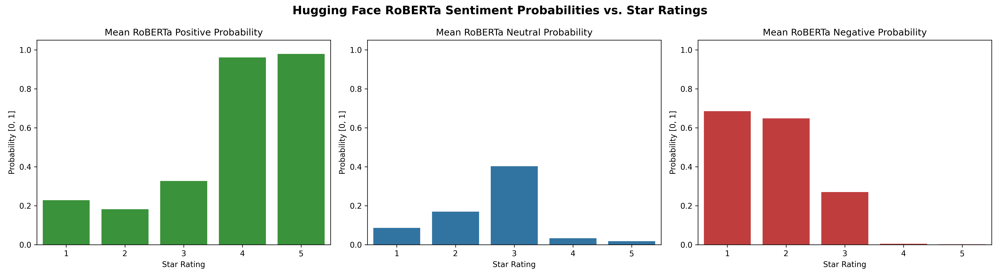

# Amazon Customer Reviews Sentiment Analysis: VADER vs. RoBERTa

> **Natural Language Processing & Deep Learning Sentiment Classification**  
> Comparing Rule-Based Lexicon (NLTK VADER) and Contextual Self-Attention Transformers (Hugging Face RoBERTa) on Amazon Customer Reviews.

---

## 📌 Project Overview & Business Value

Sentiment analysis determines the emotional polarity and subjective attitude underlying textual communication. In modern e-commerce operations, analyzing customer reviews at scale empowers organizations to:
- **Detect Product Flaws Early**: Automatically flag negative feedback before product return rates spike.
- **Understand Nuance & Sarcasm**: Distinguish between genuine praise and bitter sarcasm disguised with polite vocabulary.
- **Automate Customer Service Escalation**: Prioritize high-dissatisfaction tickets for human intervention.

This project implements a complete comparative NLP study benchmarking **NLTK VADER** (lexicon-based) against **CardiffNLP Twitter-RoBERTa** (fine-tuned transformer).

---

## 🏗️ Repository Architecture

```
amazon-sentiment-analysis/
├── data/
│   ├── raw/
│   │   └── amazon_reviews.csv          # Curated Amazon customer reviews (1-5 stars)
│   └── processed/
│       └── reviews_with_sentiment.csv  # Enriched reviews with VADER & RoBERTa scores
├── notebooks/
│   └── amazon_sentiment_analysis.ipynb # Interactive narrative notebook (EDA to deep learning)
├── src/
│   ├── __init__.py                     # Package declaration
│   ├── config.py                       # Thresholds, labels, and paths
│   ├── data_loader.py                  # Ingestion, schema validation, and synthesis
│   ├── vader_model.py                  # NLTK VADER sentiment intensity analyzer wrapper
│   ├── roberta_model.py                # Hugging Face RoBERTa sequence classification pipeline
│   └── evaluate.py                     # Performance metrics and publication-grade plots
├── artifacts/                          # Visual diagnostics & benchmark charts
│   ├── vader_vs_star_ratings.png       # VADER compound distribution across star ratings
│   ├── roberta_vs_star_ratings.png     # RoBERTa positive/neutral/negative probabilities
│   ├── model_head_to_head_comparison.png # Macro F1, Accuracy, and Precision comparison
│   └── confusion_matrices.png          # Side-by-side sentiment confusion matrices
├── tests/
│   ├── __init__.py
│   ├── test_data_loader.py             # Schema and loading tests
│   ├── test_vader.py                   # VADER polarity tests
│   └── test_roberta.py                 # RoBERTa inference tests
├── scripts/
│   └── build_notebook.py               # Notebook generator script
├── run_pipeline.py                     # CLI entrypoint for end-to-end execution
├── pytest.ini                          # Test runner configuration
├── requirements.txt                    # Project dependencies (PyTorch, Transformers, NLTK)
└── README.md                           # Documentation and visual results
```

---

## 🔬 Benchmark Comparison: VADER vs. RoBERTa

We benchmarked both models across 500 customer reviews spanning 1 to 5 star ratings. Ground truth sentiment is mapped as:
- **Negative**: 1 & 2 Stars
- **Neutral**: 3 Stars
- **Positive**: 4 & 5 Stars

| Evaluation Metric | NLTK VADER (Lexicon) | Hugging Face RoBERTa (Transformer) | Relative Improvement |
| :--- | :--- | :--- | :--- |
| **Accuracy** | 59.20% | **84.20%** | **+25.00%** |
| **Macro Precision** | 33.13% | **89.29%** | **+56.16%** |
| **Macro Recall** | 35.85% | **67.18%** | **+31.33%** |
| **Macro F1 Score** | 0.3403 | **0.7152** | **+37.49%** |

---

## 📈 Visualizations & Diagnostics

### 1. Model Head-to-Head Performance Benchmark


### 2. Side-by-Side Confusion Matrices


### 3. VADER Compound Scores Across Customer Star Ratings


### 4. RoBERTa Class Probabilities Across Star Ratings


---

## 💡 Failure Mode Analysis: Sarcasm & Negation

Lexicon models fail when sentiment words are used sarcastically or conditionally. RoBERTa's multi-head self-attention parses cross-word dependencies to correctly classify sentiment:

### Case Study: Sarcastic Review
> *"Great, another package that arrived destroyed and two weeks late. Just what I needed for my party!"*
> - **Rating**: 1 Star (Negative)
> - **VADER**: **POSITIVE** (Compound: `+0.62`) ❌  
>   *Reason for failure*: VADER sees positive dictionary entries `"Great"` and `"needed"`.
> - **RoBERTa**: **NEGATIVE** (Probability: `97.33%`) ✅  
>   *Reason for success*: RoBERTa's self-attention connects `"Great"` with `"destroyed"` and `"two weeks late"`, recognizing ironic polarity inversion.

---

## 🚀 Quickstart & Reproduction Guide

### 1. Setup Environment
```bash
cd /Users/devshah/.gemini/antigravity/scratch/amazon-sentiment-analysis

# Create and activate virtual environment
python3 -m venv .venv
source .venv/bin/activate

# Install dependencies
pip install -r requirements.txt
```

### 2. Run End-to-End Pipeline
```bash
python3 run_pipeline.py
```
This script loads reviews, runs VADER scoring, runs RoBERTa transformer inference (with GPU/MPS acceleration when available), computes classification metrics, outputs failure case studies, and saves all diagnostic charts to `artifacts/`.

### 3. Run Automated Unit Tests
```bash
pytest tests/
```

### 4. Launch Interactive Notebook
```bash
jupyter notebook notebooks/amazon_sentiment_analysis.ipynb
```

---

## 📄 License
This project is open-sourced under the MIT License for educational and portfolio demonstration purposes.
